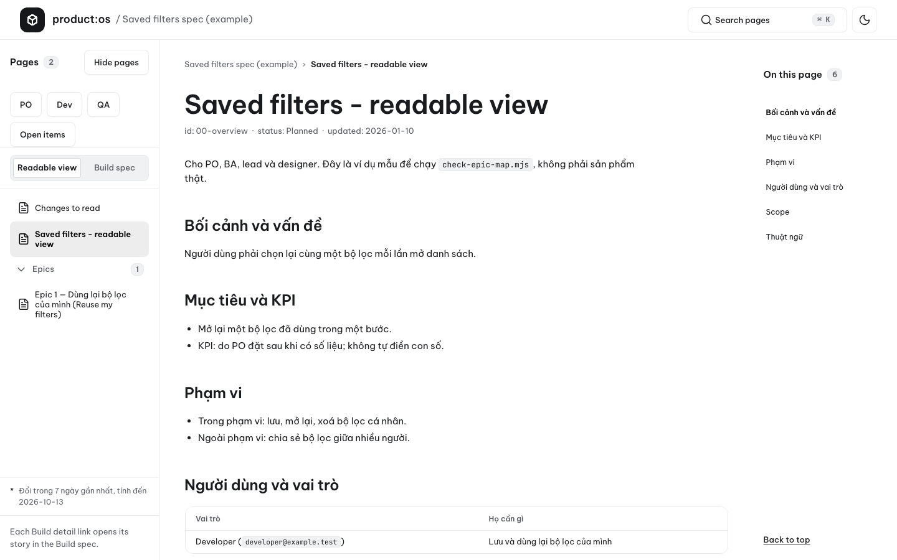
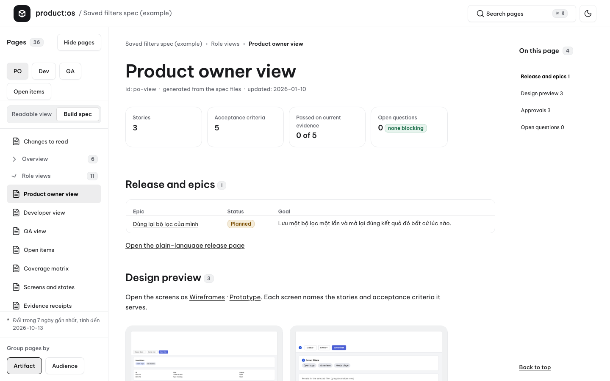
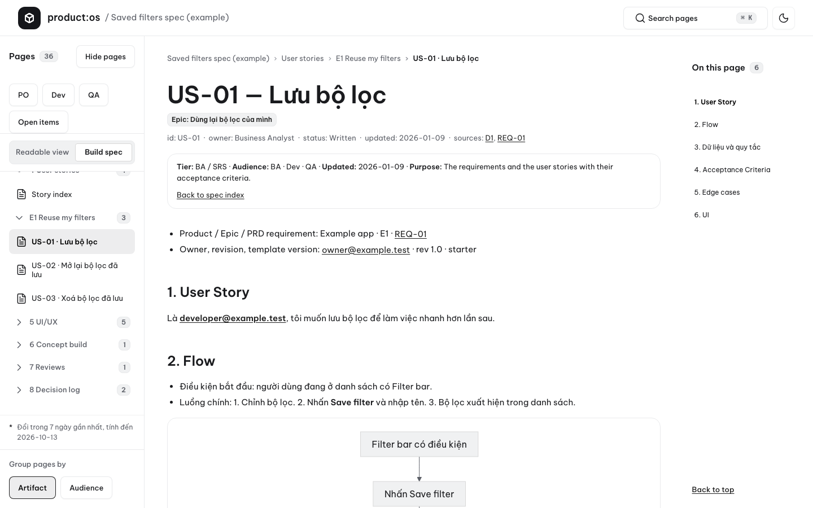
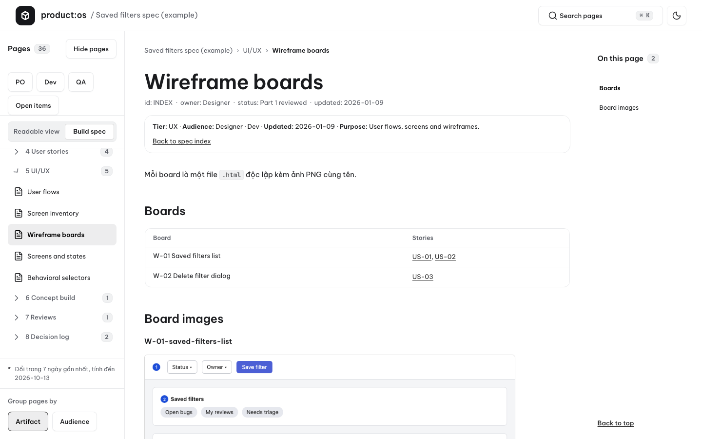
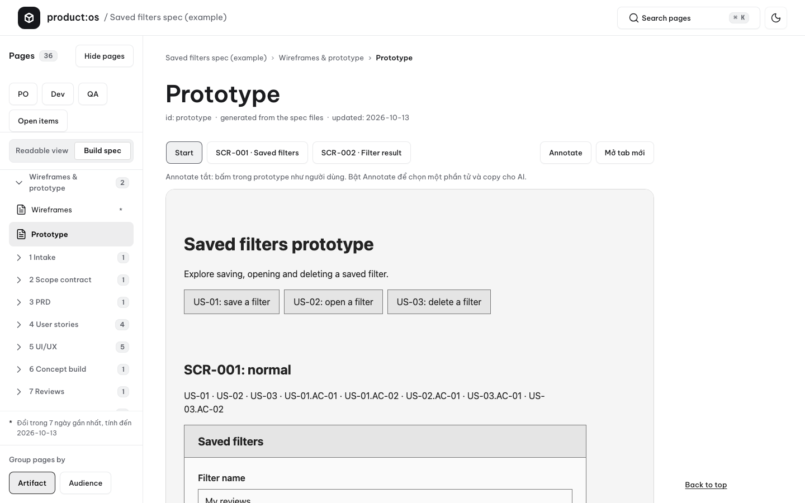

# PRODUCT:OS Spec Driven

**A source-available, local-first kit that turns a product owner's raw brief into a governed specification bundle.** It is released under the [PolyForm Noncommercial 1.0.0](LICENSE) license. Agents draft and review; the PO owns product rules, scope, and every approval.

<p align="center">
  <picture>
    <source media="(prefers-color-scheme: dark)" srcset="docs/assets/reader-saved-filters-1440-dark.png">
    
  </picture>
</p>

<p align="center">
  <a href="CHANGELOG.md"></a>
  <a href="LICENSE"></a>
  
  
  <a href="PRIVACY.md"></a>
</p>

<p align="center">
  <a href="#quickstart">Quickstart</a> · <a href="#what-it-makes">What it makes</a> · <a href="#installation">Installation</a> · <a href="#how-it-works">How it works</a> · <a href="#designos-ecosystem">Ecosystem</a>
</p>

---

## Why this exists

Raw briefs can leave scope, approvals, test intent, and handoff evidence implicit. PRODUCT:OS Spec Driven makes those decisions explicit without transferring approval authority to an agent.

| Concern | PRODUCT:OS approach |
| :--- | :--- |
| Product authority | The PO supplies the raw brief, answers clarifications, and decides gates G1–G5. Agents never approve. |
| Drafting and review | A writer produces stage output; a fresh, read-only reviewer from a different vendor reviews it. |
| Evidence | Runner exits, gate files, and PO decisions are evidence; a model completion message is not. |
| Privacy | Execution is local-first with no telemetry. See [PRIVACY.md](PRIVACY.md). |

> **Current evidence boundary:** `intake` is the only stage completed with real models. Later stages have code and tests but are **not yet proven** on a real project. See [known limits](docs/known-limits.md).

## Quickstart

### 1. Install the Claude Code plugin

```text
/plugin marketplace add jangtrinh/product-os-spec-driven
/plugin install spec@product-os-spec-driven
```

### 2. First safe use

```text
/spec:setup
/spec:new
/spec:status
```

1. `/spec:setup` runs the doctor to check the selected project and host prerequisites.
2. `/spec:new` creates a project from PO-owned inputs.
3. `/spec:status` inspects gate state, counters, and questions before continuing.

Then the working loop: `/spec:run` drafts or resumes the configured pipeline; `/spec:gate` records a decision only after the PO chooses; `/spec:view` opens the reader output; `/spec:upgrade` previews and asks before an upgrade.

Use `/spec:clarify`, `/spec:gate`, `/spec:status`, `/spec:view`, and `/spec:upgrade` as the PO workflow requires. The detailed Vietnamese PO working guide is [docs/po-guide.md](docs/po-guide.md); short command guidance is [docs/po-quickstart.md](docs/po-quickstart.md).

### 3. Verify the kit checkout

```bash
python3 scripts/self_check.py
```

The check is local and deterministic; inspect its actual exit and output rather than treating this README as proof. See [scripts/self_check.py](scripts/self_check.py) and [commands/doctor.md](commands/doctor.md).

## What it makes

The enabled pipeline turns `input/po-spec.md` into linked specification material and process records:

```text
intake (G1) → clarify → contract (G2) → prd → us → wireframe → prototype → [design] → tdd (G3) → [uiux] (G4) → handoff (G5)
```

`[design]` and `[uiux]` are disabled by default. The kit can produce intake records, contracts, PRDs, user stories, scenarios/tests, wireframes, prototypes, reviews, gate records, and a handoff. Each remains subject to the evidence boundary above.

| Gate | Stage | PO decision point |
| :--- | :--- | :--- |
| G1 | `intake` | Source, manifest, glossary, and ledger are ready to inspect. |
| G2 | `contract` | Product contract and decisions are ready to inspect. |
| G3 | `us` / `tdd` | User stories and their scenario/test material are ready to inspect. |
| G4 | `uiux` | Enabled UI/UX output has its required evidence. |
| G5 | `handoff` | The release-ready specification handoff is ready to inspect. |

### Gallery

Real captures of the offline reader, rendered from the generic saved-filters example spec (1440 px, light).

**Overview, without a hidden handoff.** The reader organizes the material the pipeline makes available to inspect.



**PO decisions remain in view.** The PO owns the rules, scope, and approvals that move work forward.



**Stories stay linked to the record.** User-story material remains part of the governed specification bundle.



**Wireframe boards, ready to inspect.** The default flow can create linked wireframe material subject to its evidence boundary.



**Prototype material with annotation.** Prototype output can be opened offline for review before the PO decides the next gate.



## Installation

### Claude Code

Install with the two plugin commands in Quickstart. The plugin exposes the `spec` command family.

### Codex and Grok

Install host files from a checkout with the host installer:

```bash
node scripts/install-hosts.mjs --host codex
node scripts/install-hosts.mjs --host grok
```

Use `--check` for a read-only installation check. Codex and Grok use parity command names such as `spec-status`. The installer is [scripts/install-hosts.mjs](scripts/install-hosts.mjs); the Codex prompt mirror is [prompts/doctor.md](prompts/doctor.md).

Factory has plugin manifests that have not been smoke-tested.

### Writer and reviewer choices

Writers may use Codex, Claude Code, or manual mode. Reviewers may use Codex, Claude Code, Grok, or manual mode; Grok is reviewer-only. Choose a reviewer from a different vendor than the writer, and run the reviewer in a fresh, read-only session.

## How it works

1. The PO provides a raw brief and approved context.
2. The writer drafts the active stage; deterministic linting checks structure and references.
3. A different-vendor reviewer evaluates the final draft in a fresh, read-only session.
4. The runner records a pending or non-required gate. The PO decides whether work proceeds.

| Exit | Meaning |
| :--- | :--- |
| `0` | Enabled stages are settled and gates remain current; this is not production acceptance. |
| `2` | Waiting for the PO, a pending gate, a manual checkpoint, or an exhausted round limit. |
| `3` | Invalid input, configuration, or gate state. |
| `4` | A tool or agent failed, including a timeout. |

### What loads when

| Step | Files loaded | Purpose |
| :--- | :--- | :--- |
| Plugin command | `skills/<command>/SKILL.md` and shared rules | Routes `/spec:*` work and preserves PO authority. |
| Runner | `tools/run/run.mjs` and selected prompt/template contracts | Runs the selected stage and deterministic checks. |
| Stage context | `config/pipeline.yaml` plus declared stage sources | Supplies configured context for the active stage. |
| Independent review | Reviewer prompt, rubric, sources, and final output | Supports a fresh, read-only review by a different vendor. |

Browse [docs/cookbook.md](docs/cookbook.md) for prompt recipes. Read [SPEC.md](SPEC.md) for the complete process contract and [docs/architecture.md](docs/architecture.md) for the kit architecture.

## File structure

```text
product-os-spec-driven/
├── skills/                 # plugin skill entry points
├── commands/doctor.md      # Claude Code diagnostic command
├── prompts/doctor.md       # Codex diagnostic prompt mirror
├── scripts/                # host installer and self-check
├── config/pipeline.yaml    # stages, roles, and declared context
├── tools/run/              # init, runner, doctor, gate, and status tools
├── docs/                   # cookbook, PO guide, and known limits
├── SPEC.md                 # full process contract
└── README.md
```

### Command registry

| Command | Where | Purpose |
| :--- | :--- | :--- |
| `/spec:setup` | Claude Code | Check the selected project and host prerequisites. |
| `/spec:new` | Claude Code | Create a project from PO-owned inputs. |
| `/spec:run` | Claude Code | Run or resume the configured pipeline. |
| `/spec:gate` | Claude Code | Record a gate decision only after the PO's in-session choice. |
| `/doctor` | Claude Code / Codex | Read-only diagnostic entry point. |

### It's working if...

- `python3 scripts/self_check.py` exits successfully and reports actual findings.
- The runner records the expected exit code and gate state for the project run.
- The PO, not an agent, makes every gate decision.
- Writer and reviewer are different vendors, and the reviewer is fresh and read-only.

### When not to use

- When a team wants an agent to silently approve product scope or release decisions.
- When a project needs a claim that later stages have already been proven with real models; they have not.
- When inputs cannot be safely prepared as PO-owned source material or approval cannot remain with a named PO.

<details>
<summary>FAQ</summary>

**Is this open source?** No. This is a source-available kit under the [PolyForm Noncommercial 1.0.0](LICENSE) license; use and redistribution are governed by that license.

**Can an agent approve a gate?** No. `/spec:gate` records a decision only after the PO makes the choice in the same session; agents never approve.

**Which stages have been proven in a real project?** Only `intake` has completed a real-model run. Later stages remain not yet proven even where code and tests exist; see [docs/known-limits.md](docs/known-limits.md).

**What if no supported CLI is available?** Use manual mode. The runner keeps the gate pending until the required human action and evidence are available.

</details>

## DESIGN:OS Ecosystem

### PRODUCT:OS

| Kit | Live docs | Repository | Layer |
| :--- | :--- | :--- | :--- |
| **PRODUCT:OS Spec Driven** | [jangtrinh.github.io/product-os-spec-driven](https://jangtrinh.github.io/product-os-spec-driven/) | [`jangtrinh/product-os-spec-driven`](https://github.com/jangtrinh/product-os-spec-driven) | `product specification` |

### DESIGN:OS

| Engine | Live Docs | Repository | Layer |
| :--- | :--- | :--- | :--- |
| **DESIGN:OS CLI** | [jangtrinh.github.io/design-os](https://jangtrinh.github.io/design-os/) | [`jangtrinh/design-os`](https://github.com/jangtrinh/design-os) | `cli` |
| **Knowledge Builder** | [jangtrinh.github.io/design-os-knowledge-builder](https://jangtrinh.github.io/design-os-knowledge-builder/) | [`jangtrinh/design-os-knowledge-builder`](https://github.com/jangtrinh/design-os-knowledge-builder) | `compiler` |
| **Figma Plugin & CLI** | [jangtrinh.github.io/design-os-figma-plugin](https://jangtrinh.github.io/design-os-figma-plugin/) | [`jangtrinh/design-os-figma-plugin`](https://github.com/jangtrinh/design-os-figma-plugin) | `plugin` |
| **SVG Animation Engine** | [jangtrinh.github.io/design-os-svg-animation](https://jangtrinh.github.io/design-os-svg-animation/) | [`jangtrinh/design-os-svg-animation`](https://github.com/jangtrinh/design-os-svg-animation) | `engine` |
| **3D Blender Agent** | [jangtrinh.github.io/design-os-3d-blender](https://jangtrinh.github.io/design-os-3d-blender/) | [`jangtrinh/design-os-3d-blender`](https://github.com/jangtrinh/design-os-3d-blender) | `3d / cad` |
| **OPAH ONE Drone** | [jangtrinh.github.io/design-os-drone-showcase](https://jangtrinh.github.io/design-os-drone-showcase/) | [`jangtrinh/design-os-drone-showcase`](https://github.com/jangtrinh/design-os-drone-showcase) | `hardware` |
| **GitHub Pages Engine** | [jangtrinh.github.io/design-os-github-page](https://jangtrinh.github.io/design-os-github-page/) | [`jangtrinh/design-os-github-page`](https://github.com/jangtrinh/design-os-github-page) | `pages` |
| **Apple Design OS** | [jangtrinh.github.io/design-os-apple](https://jangtrinh.github.io/design-os-apple/) | [`jangtrinh/design-os-apple`](https://github.com/jangtrinh/design-os-apple) | `swiftui` |
| **Agent Teacher** | [jangtrinh.github.io/design-os-pedagogy](https://jangtrinh.github.io/design-os-pedagogy/) | [`jangtrinh/design-os-pedagogy`](https://github.com/jangtrinh/design-os-pedagogy) | `pedagogy` |
| **Origami CAD** | [jangtrinh.github.io/design-os-origami](https://jangtrinh.github.io/design-os-origami/) | [`jangtrinh/design-os-origami`](https://github.com/jangtrinh/design-os-origami) | `packaging` |
| **Voice UX Architecture** | [jangtrinh.github.io/design-os-voice-ux](https://jangtrinh.github.io/design-os-voice-ux/) | [`jangtrinh/design-os-voice-ux`](https://github.com/jangtrinh/design-os-voice-ux) | `voice-ai` |
| **Code2Flow** | [jangtrinh.github.io/design-os-code2flow](https://jangtrinh.github.io/design-os-code2flow/) | [`jangtrinh/design-os-code2flow`](https://github.com/jangtrinh/design-os-code2flow) | `ast / audit` |
| **Generative UI** | [jangtrinh.github.io/design-os-generative-ui](https://jangtrinh.github.io/design-os-generative-ui/) | [`jangtrinh/design-os-generative-ui`](https://github.com/jangtrinh/design-os-generative-ui) | `runtime` |

## Governance and license

- [Contributing](CONTRIBUTING.md) explains contribution expectations and checks.
- [Kit feedback](docs/feedback.md) explains how a PO's AI prepares a redacted issue draft and asks before posting it.
- [Security](SECURITY.md) covers vulnerability reporting; [privacy](PRIVACY.md) documents the local-first, no-telemetry stance.
- [Code of Conduct](CODE_OF_CONDUCT.md) governs participation; [CHANGELOG.md](CHANGELOG.md) records releases.
- [llms.txt](llms.txt) is the machine-readable discovery index.
- [LICENSE](LICENSE) is PolyForm Noncommercial 1.0.0.
