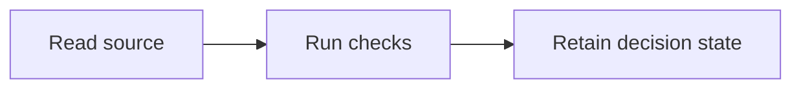

## 1. User Story
As PO I want the declared control behavior so unresolved choices remain visible.

## 2. Flow
Read source, run checks, retain the current decision state.

## 3. Data and rules
Only source-backed outcomes may become accepted requirements.

## 4. Acceptance Criteria
| ID | Given | When | Then |
|---|---|---|---|
| AC-01 | The supplied PO input | Evaluate the current candidate | PO mặc định bật và có gate |
| AC-02 | The supplied PO input | Evaluate the current candidate | QC và Dev mặc định tắt |
| AC-03 | The supplied PO input | Evaluate the current candidate | TDD thuộc QC |
| AC-04 | The supplied PO input | Evaluate the current candidate | PRD và US có kết quả quan sát |
| AC-05 | The supplied PO input | Evaluate the current candidate | Gate lưu SHA-256 và chờ PO |
| AC-06 | The supplied PO input | Evaluate the current candidate | Eval lưu kết quả và đối chiếu lần trước |

## 5. Edge cases
Missing authority keeps dependent scope pending.
OPEN: PO chưa chọn design system cho UIUX.

## 6. UI
No UI in this control story; product visual acceptance remains separately unavailable.
