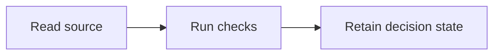

## 1. User Story
As PO I want the declared control behavior so unresolved choices remain visible.

## 2. Flow
Read source, run checks, retain the current decision state.

## 3. Data and rules
Only source-backed outcomes may become accepted requirements.

## 4. Acceptance Criteria
| ID | Given | When | Then |
|---|---|---|---|
| AC-01 | The supplied PO input | Evaluate the current candidate | Role toggles cannot clear PENDING |
| AC-02 | The supplied PO input | Evaluate the current candidate | Manual self-review does not establish independence |

## 5. Edge cases
Missing authority keeps dependent scope pending.
OPEN: PO has not approved this pending scope.

## 6. UI
No UI in this control story; product visual acceptance remains separately unavailable.
