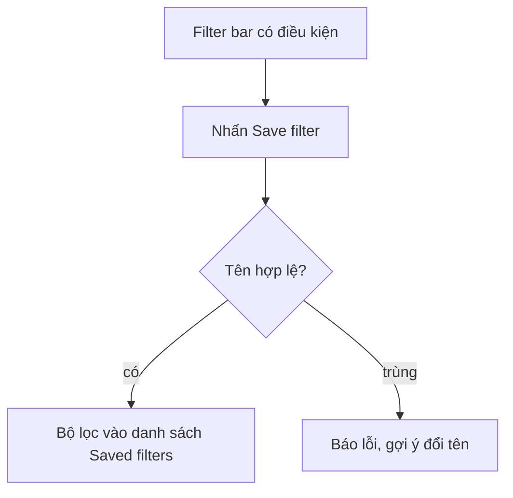
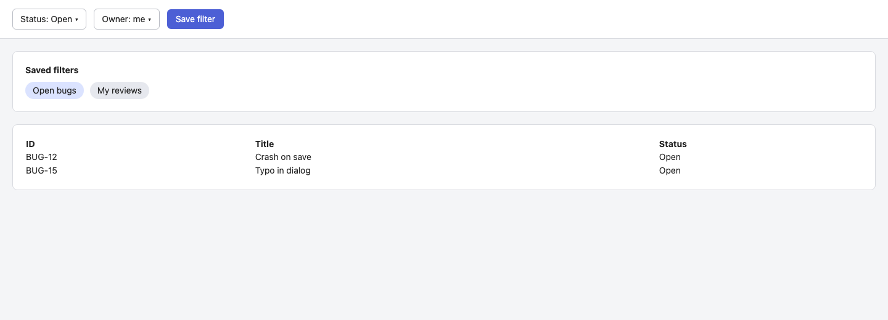

- Product / Epic / PRD requirement: Example app · E1 · REQ-01
- Owner, revision, template version: owner@example.test · rev 1.0 · starter

## 1. User Story
Là **developer@example.test**, tôi muốn lưu bộ lọc để làm việc nhanh hơn lần sau.

## 2. Flow
- Điều kiện bắt đầu: người dùng đang ở danh sách có Filter bar.
- Luồng chính: 1. Chỉnh bộ lọc. 2. Nhấn **Save filter** và nhập tên. 3. Bộ lọc xuất hiện trong danh sách.



## 3. Dữ liệu và quy tắc

| ID | Quy tắc | Nguồn |
|---|---|---|
| **BR-01** | Tên bộ lọc dài tối đa 40 ký tự và không trùng trong cùng người dùng. | [contract](../contract/FC-001.md) D1 |

## 4. Acceptance Criteria

| ID | Given | When | Then | Scenario |
|---|---|---|---|---|
| AC-01 | Danh sách đang có điều kiện lọc | Nhấn Save filter và nhập tên hợp lệ | Bộ lọc xuất hiện trong danh sách đã lưu. | SCN-01-01 |
| AC-02 | Đã có bộ lọc cùng tên | Nhập lại tên đó | Báo lỗi dưới ô nhập và gợi ý đổi tên. | SCN-01-02 |

## 5. Edge cases
- Rỗng: chưa có bộ lọc nào, hiện empty state một hành động.
- Lỗi: tên trùng, báo ngay dưới ô nhập kèm cách sửa.

## 6. UI
Màn hình S01 (Filter bar + Saved filters). Ảnh chụp bản build:



```text
+--------------------------------------------------+
| Filter bar   [Status v] [Owner v]  [Save filter] |
+--------------------------------------------------+
| Saved filters:  ( Open bugs )  ( My reviews )    |
+--------------------------------------------------+
```
