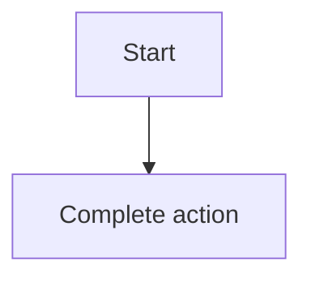

- Product / Epic / PRD requirement: Example app · E1 · REQ-02
- Owner, revision, template version: owner@example.test · rev 1.0 · starter

## 1. User Story
Là **developer@example.test**, tôi muốn mở lại bộ lọc đã lưu để làm việc nhanh hơn lần sau.

## 2. Flow
- Điều kiện bắt đầu: người dùng đang ở danh sách có Filter bar.
- Luồng chính: 1. Mở danh sách Saved filters. 2. Chọn một bộ lọc. 3. Danh sách hiện đúng kết quả cũ.



## 3. Dữ liệu và quy tắc

| ID | Quy tắc | Nguồn |
|---|---|---|
| **BR-01** | Tên bộ lọc dài tối đa 40 ký tự và không trùng trong cùng người dùng. | [contract](../contract/FC-001.md) D1 |

## 4. Acceptance Criteria

| ID | Given | When | Then | Scenario |
|---|---|---|---|---|
| AC-01 | Có một bộ lọc đã lưu | Chọn bộ lọc đó | Danh sách hiện đúng các dòng đã lọc lúc lưu. PneumonoultramicroscopicsilicovolcanoconiosisPneumonoultramicroscopicsilicovolcanoconiosisPneumonoultramicroscopicsilicovolcanoconiosis Người dùng thấy kết quả đúng như lúc lưu, kể cả khi danh sách rất dài. Người dùng thấy kết quả đúng như lúc lưu, kể cả khi danh sách rất dài. Người dùng thấy kết quả đúng như lúc lưu, kể cả khi danh sách rất dài. Người dùng thấy kết quả đúng như lúc lưu, kể cả khi danh sách rất dài. Người dùng thấy kết quả đúng như lúc lưu, kể cả khi danh sách rất dài. Người dùng thấy kết quả đúng như lúc lưu, kể cả khi danh sách rất dài.  | SCN-02-01 |

## 5. Edge cases

| Cột 1 | Cột 2 | Cột 3 | Cột 4 | Cột 5 | Cột 6 | Cột 7 | Cột 8 | Cột 9 | Cột 10 | Cột 11 | Cột 12 |
|---|---|---|---|---|---|---|---|---|---|---|---|
| giá trị 1 | giá trị 2 | giá trị 3 | PneumonoultramicroscopicsilicovolcanoconiosisPneumonoultramicroscopicsilicovolcanoconiosisPneumonoultramicroscopicsilicovolcanoconiosis | giá trị 5 | giá trị 6 | giá trị 7 | giá trị 8 | giá trị 9 | giá trị 10 | giá trị 11 | giá trị 12 |

```text
xxxxxxxxxxxxxxxxxxxxxxxxxxxxxxxxxxxxxxxxxxxxxxxxxxxxxxxxxxxxxxxxxxxxxxxxxxxxxxxxxxxxxxxxxxxxxxxxxxxxxxxxxxxxxxxxxxxxxxxxxxxxxxxxxxxxxxxxxxxxxxxxxxxxxxxxxxxxxxxxxxxxxxxxxxxxxxxxxxxxxxxxxxxxxxxxxxxxxxxxxxxxxxxxxxxxxxxxxxxxxxxxxxxxxxxxxxxxxxxxxxxxxxxxxxxxxxxxxxxx
```

- Rỗng: chưa có bộ lọc nào, hiện empty state một hành động.
- Lỗi: tên trùng, báo ngay dưới ô nhập kèm cách sửa.

## 6. UI
Màn hình S02. Chưa có bản build, bảng wireframe thay thế:


OPEN: Người dùng mở lại bộ lọc rất dài thì hiển thị thế nào? Người dùng mở lại bộ lọc rất dài thì hiển thị thế nào? Người dùng mở lại bộ lọc rất dài thì hiển thị thế nào? Người dùng mở lại bộ lọc rất dài thì hiển thị thế nào? Người dùng mở lại bộ lọc rất dài thì hiển thị thế nào? PneumonoultramicroscopicsilicovolcanoconiosisPneumonoultramicroscopicsilicovolcanoconiosisPneumonoultramicroscopicsilicovolcanoconiosis Owner: owner@example.test
