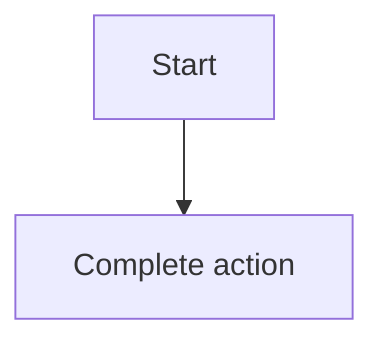

- Product / Epic / PRD requirement: Example app · E1 · REQ-02
- Owner, revision, template version: owner@example.test · rev 1.0 · starter

## 1. User Story
Là **developer@example.test**, tôi muốn mở lại bộ lọc đã lưu để làm việc nhanh hơn lần sau.

## 2. Flow
- Điều kiện bắt đầu: người dùng đang ở danh sách có Filter bar.
- Luồng chính: 1. Mở danh sách Saved filters. 2. Chọn một bộ lọc. 3. Danh sách hiện đúng kết quả cũ.

## 3. Dữ liệu và quy tắc

| ID | Quy tắc | Nguồn |
|---|---|---|
| **BR-01** | Tên bộ lọc dài tối đa 40 ký tự và không trùng trong cùng người dùng. | [contract](../contract/FC-001.md) D1 |

## 4. Acceptance Criteria

| ID | Given | When | Then | Scenario |
|---|---|---|---|---|
| AC-01 | Có một bộ lọc đã lưu | Chọn bộ lọc đó | Danh sách hiện đúng các dòng đã lọc lúc lưu. | SCN-02-01 |

## 5. Edge cases
- Rỗng: chưa có bộ lọc nào, hiện empty state một hành động.
- Lỗi: tên trùng, báo ngay dưới ô nhập kèm cách sửa.

## 6. UI
Màn hình S02. Chưa có bản build, bảng wireframe thay thế:

