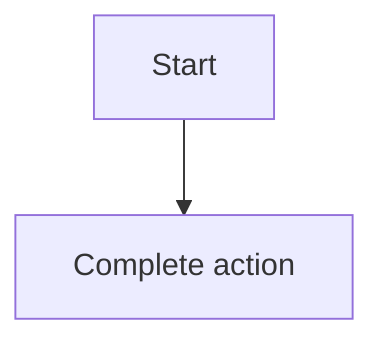

- Product / Epic / PRD requirement: Example app · E1 · REQ-03
- Owner, revision, template version: owner@example.test · rev 1.0 · starter

## 1. User Story
Là **developer@example.test**, tôi muốn xoá bộ lọc đã lưu để làm việc nhanh hơn lần sau.

## 2. Flow
- Điều kiện bắt đầu: người dùng đang ở danh sách có Filter bar.
- Luồng chính: 1. Chọn **Delete filter**. 2. Hộp thoại xác nhận nêu tên. 3. Xác nhận, bộ lọc biến mất. Quyết định D2.

## 3. Dữ liệu và quy tắc

| ID | Quy tắc | Nguồn |
|---|---|---|
| **BR-01** | Tên bộ lọc dài tối đa 40 ký tự và không trùng trong cùng người dùng. | [contract](../contract/FC-001.md) D1 |

## 4. Acceptance Criteria

| ID | Given | When | Then | Scenario |
|---|---|---|---|---|
| AC-01 | Có một bộ lọc đã lưu | Chọn Delete filter và xác nhận | Bộ lọc biến mất khỏi danh sách đã lưu. | SCN-03-01 |
| AC-02 | Có một bộ lọc đã lưu | Chọn Delete filter rồi huỷ | Không có gì thay đổi. | SCN-03-02 |

## 5. Edge cases
- Rỗng: chưa có bộ lọc nào, hiện empty state một hành động.
- Lỗi: tên trùng, báo ngay dưới ô nhập kèm cách sửa.

## 6. UI
Màn hình S03: hộp thoại xác nhận xoá. Xem wireframe boards.
