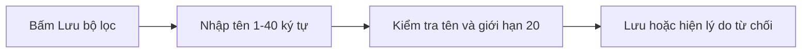

## 1. User Story
Là nhân viên vận hành đơn hàng, tôi muốn lưu tổ hợp điều kiện lọc hiện tại thành bộ lọc có tên để dùng lại bằng một lần bấm.

## 2. Flow
| Bước | Hành động | Phản hồi |
|---|---|---|
| 1 | Người dùng lọc danh sách đơn và bấm Lưu bộ lọc | Hệ thống mở hộp thoại lưu với ô nhập tên |
| 2 | Người dùng nhập tên dài từ 1 đến 40 ký tự và bấm Lưu | Hệ thống kiểm tra độ dài tên, tên trùng và giới hạn 20 bộ lọc |
| 3 | Hệ thống lưu bộ lọc hoặc từ chối | Bộ lọc xuất hiện trong danh sách kèm thông báo đã lưu, hoặc hộp thoại hiển thị lý do từ chối |



## 3. Data and rules
- Đầu vào: tên dài từ 1 đến 40 ký tự và bộ điều kiện lọc hiện tại; tên trùng tên bộ lọc khác của cùng người dùng bị từ chối theo D4 và FC-01.AC-02.
- Mỗi người dùng lưu tối đa 20 bộ lọc theo D3; bộ lọc thứ 21 bị từ chối theo FC-01.AC-02.

## 4. Acceptance Criteria
| ID | Given | When | Then | Source |
|---|---|---|---|---|
| AC-01 | Người dùng đang lọc danh sách đơn, nhập tên dài từ 1 đến 40 ký tự chưa dùng và đang có dưới 20 bộ lọc | Bấm nút Lưu trong hộp thoại lưu | Hệ thống thêm bộ lọc vào danh sách bộ lọc và hiển thị thông báo Đã lưu bộ lọc | FC-01.AC-01 |
| AC-02 | Tên rỗng, dài hơn 40 ký tự, trùng tên bộ lọc khác, hoặc người dùng đã có 20 bộ lọc | Nhập tên hoặc bấm nút Lưu | Hệ thống vô hiệu hóa nút Lưu hoặc hiển thị lý do từ chối tại hộp thoại và không tạo bộ lọc | FC-01.AC-02 |

## 5. Edge cases
- Tên chỉ chứa khoảng trắng: nút Lưu bị vô hiệu hóa như tên rỗng.
- Tên trùng chỉ khác hoa thường: hệ thống coi là trùng và từ chối.

## 6. UI
Màn hình SCR-001 là hộp thoại lưu bộ lọc. Chưa có bản build thực tế.
```text
[Hộp thoại lưu - SCR-001] [Ô nhập tên <= 40 ký tự] [Nút Lưu] [Lý do từ chối]
```
| Scenario | AC | Precondition / data | Steps | Expected | Method / evidence |
|---|---|---|---|---|---|
| SCN-01-01 | AC-01 | Tên hợp lệ chưa dùng, người dùng có dưới 20 bộ lọc | Nhập tên và bấm Lưu trên SCR-001 | Bộ lọc xuất hiện trong danh sách kèm thông báo Đã lưu bộ lọc | review; planned |
| SCN-01-02 | AC-02 | Tên rỗng, dài hơn 40 ký tự, trùng tên hoặc đã đủ 20 bộ lọc | Nhập tên hoặc bấm Lưu trên SCR-001 | Nút Lưu bị vô hiệu hóa hoặc hộp thoại hiện lý do từ chối | review; planned |
