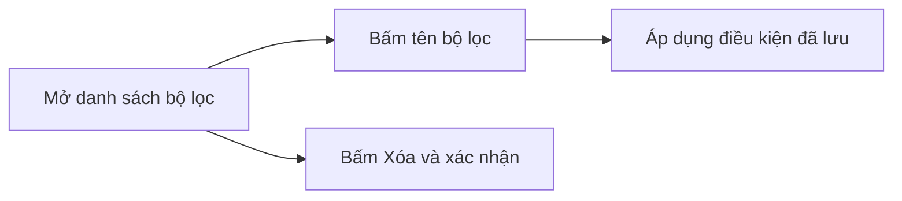

## 1. User Story
Là nhân viên vận hành đơn hàng, tôi muốn bấm vào bộ lọc đã lưu để áp dụng lại điều kiện và xóa bộ lọc không còn dùng.

## 2. Flow
| Bước | Hành động | Phản hồi |
|---|---|---|
| 1 | Người dùng mở danh sách bộ lọc đã lưu | Hệ thống hiển thị tối đa 20 bộ lọc của chính người dùng |
| 2 | Người dùng bấm vào tên một bộ lọc | Hệ thống áp dụng toàn bộ điều kiện đã lưu lên danh sách đơn |
| 3 | Người dùng bấm Xóa và xác nhận | Hệ thống xóa bộ lọc khỏi danh sách và giữ nguyên danh sách đơn đang hiển thị |



## 3. Data and rules
- Danh sách chỉ hiển thị bộ lọc của người dùng hiện tại theo D2 và FC-01.AC-03.
- Xóa bộ lọc không làm đổi danh sách đơn đang hiển thị.

## 4. Acceptance Criteria
| ID | Given | When | Then | Source |
|---|---|---|---|---|
| AC-01 | Người dùng có ít nhất một bộ lọc đã lưu | Bấm vào tên bộ lọc trong danh sách bộ lọc | Danh sách đơn áp dụng đúng điều kiện đã lưu của bộ lọc đó | FC-01.AC-03 |
| AC-02 | Người dùng có ít nhất một bộ lọc đã lưu | Bấm nút Xóa rồi bấm Xác nhận xóa | Bộ lọc biến mất khỏi danh sách bộ lọc và danh sách đơn đang hiển thị không đổi | FC-01.AC-03 |

## 5. Edge cases
- Người dùng chưa lưu bộ lọc nào: danh sách hiển thị trạng thái rỗng.
- Người dùng bấm Hủy trong bước xác nhận xóa: bộ lọc được giữ nguyên.

## 6. UI
Màn hình SCR-002 hiển thị danh sách bộ lọc đã lưu. Chưa có bản build thực tế.
```text
[Danh sách bộ lọc - SCR-002] [Tên bộ lọc] [Nút Áp dụng] [Nút Xóa]
```
| Scenario | AC | Precondition / data | Steps | Expected | Method / evidence |
|---|---|---|---|---|---|
| SCN-02-01 | AC-01, AC-02 | Người dùng có ít nhất một bộ lọc đã lưu | Mở SCR-002, bấm tên bộ lọc rồi bấm Xóa và xác nhận | Danh sách đơn áp dụng điều kiện đã lưu; bộ lọc biến mất sau khi xóa | review; planned |
