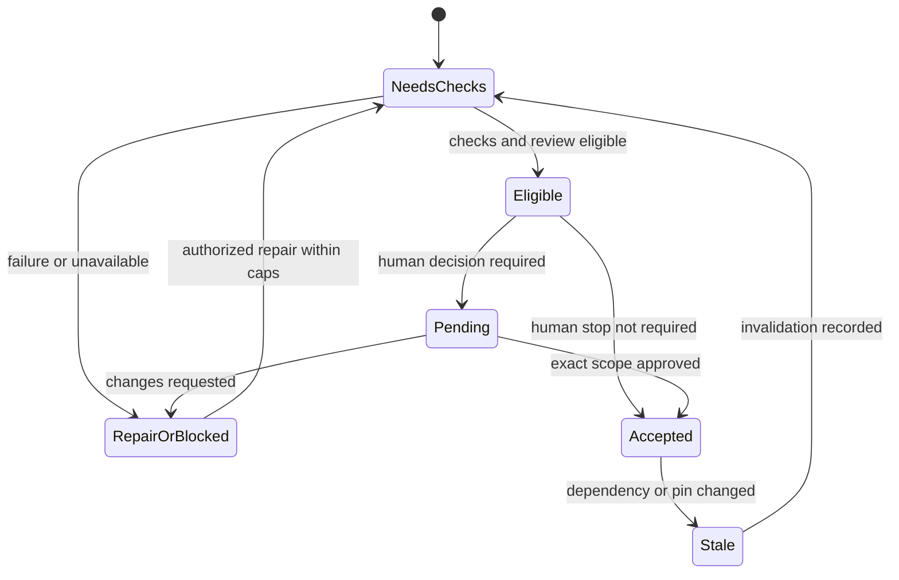
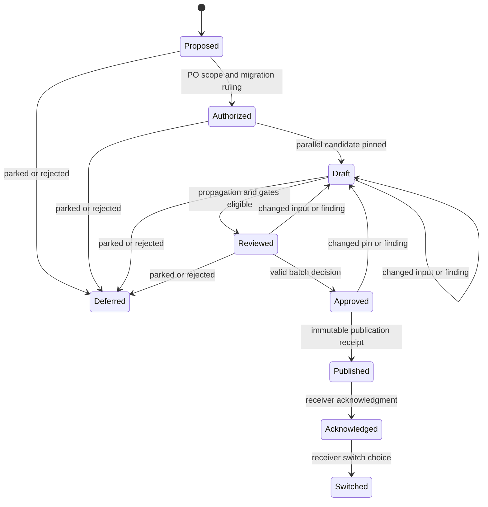

# Loop and gate model

Normative companion to [Format v2](SPEC-FORMAT-v2.md). MUST/MUST NOT are requirements. This model owns transitions and exact-version decisions; the stage order remains the default traversal. It creates no worker scheduler and grants no permission to deploy or merge.

## 1. Traversal and legal transitions

Default traversal is intake → clarify → contract → prd → us → design → tdd → uiux → handoff, skipping disabled stages. UIUX still requires enabled design and TDD plus a declared DS adapter. G1 intake, G2 contract, G3 us/TDD, G4 UIUX, G5 handoff remain aggregate checkpoints. A stage gate and a feature checkpoint may share evidence but remain distinct decisions. Global lint/render/verify and required corpus checks run again after any changed bundle, even when semantic re-approval is scoped.

| Transition | Preconditions and authority | Result |
|---|---|---|
| advance | current required checks, independent review and required human decisions for exact scope | next enabled stage; disabled human stop is NOT_REQUIRED, not quality approval |
| same-stage repair | reproducible finding, same accepted requirements; persisted caps available | writer edit → affected eval → fresh focused read-only review; old receipts stale |
| backward re-entry | transition record, impact closure, authority decision; PO resolves requirement/scope choices | affected earlier artifact reopened; dependent gates invalidated; independent scopes retained only with proof |
| prototype-first | current scoped PO-approved exception before work, with deferred gates and expiry | draft/prototype may precede contract; combined approval still required before normal continuation |
| post-handoff change | Change Set from immutable baseline in use; PO scope/migration/backlog ruling | parallel draft and affected re-gates; old receiver baseline remains valid until explicit switch |
| recovery | harness/environment finding with recovery action, no product-law change | repair measurement, re-evaluate unchanged AC; never classify environment failure as behavioral RED |

Every backward move MUST have a [transition](schema/transition.schema.json): `id`, `kind` (`backward`), `opener` email/role, `at` UTC, `source`, `reason`, `from`/`to` each `{stage, scope, revision}`, `impact` rows, `authority` (`po|qc|dev`), `decision` (decision record id or null while proposed), and `regates` gate ids. Product changes require PO even if the source stage owner is another role. Proposal alone cannot authorize execution. Same-stage repair uses kind `repair`; recovery uses `recovery`; prototype and post-handoff use `exception`/`change-set` plus their record refs in source.

Clarify MUST read prior answers/rulings first, deduplicate by subject/scope, and persist question id, question, dependencies, asked round, answer/source and disposition `open|answered|superseded|deferred`. Hold only dependent content. Re-entry MUST reuse accepted decisions rather than re-ask them. A deferred blocking AC remains blocked; a disposition is not an invented answer. Inline US OPEN remains canonical.

## 2. Definitions, scope and runtime records

A [gate definition](schema/gate-definition.schema.json) requires `id`, `version`, `stage`, `scope`, `inputs`, `outputs`, `checks`, `reviewer`, `decider`, `transitions`, `invalidation`, `exceptions`, and `versions`. Check entries are `{id, command, mandatory, blocker_policy}` with nonempty policy; input/output arrays contain declared paths. Reviewer is a read-only identity/role, decider is po/qc/dev. `transitions` is the allowed subset of the transition table. `invalidation` declares graph closure and BR-14 fallback. Exceptions name approved records, never free-form bypass flags. Pin workflow/templates/ruleset/skill versions (skill may be `none` for a tool-only run); no model is mandated.

Scope is `{kind: stage|artifact|bundle|us|ac, ids: [...], revision: nonempty}`. IDs are an explicit nonempty sorted unique list, not a wildcard/count. Stage ids use the stage namespace; artifact ids use bundle-relative paths; bundle ids are project-declared feature ids; US ids follow Format §4; AC ids are qualified by US or contract. Approval covers the exact enumerated members and their per-member hashes in the pinned candidate manifest, never everything with the same label. The exact [candidate manifest and registry bindings](packet-interchange.md#2-candidate-member-and-hash-manifest) enumerate every member/artifact digest; Definition and gate scope.revision pins only `{definition:{id,version},kind,ids}` with sorted ids, while receipt/packet scope.revision pins the selected content member-record digest and candidate.manifest pins the full content manifest. Rewriting member content retains the definition; membership changes require a new definition version. Qualified contract AC/amendment: `<contract-document-id>.AC-n` / `<contract-document-id>.A-n`; retired ids are never reused. Existing bare primary-contract amendment refs remain valid.

`review/gates/<stage>.md` retains its exact first line and legacy gate-data fields. New runner records additionally require `model` conforming to [gate-state.schema.json](schema/gate-state.schema.json): `definition` `{id,version}`, `scope`, `states`, `receipts` receipt ids, `rounds`, `decision` decision id or null, `exception_ids`, and `candidate` `{head,base,manifest,build}` pinned nonempty digests/revisions. Historical records without model are readable as legacy but cannot establish new scoped approval. Scoped records live in `review/gates/scoped/<gate-id>/<revision>.json`; the stage file summarizes all required scopes. One approved scope cannot hide another pending scope.

## 3. Orthogonal states and crosswalk

| Dimension | Values | Meaning |
|---|---|---|
| eval | PASS, FAIL, BLOCKED, NOT_RUN, SKIPPED, NA | command/coverage observation; skipped needs reason, NA needs authority confirmer |
| review | PASS, NEEDS_CHANGES, FAIL, BLOCKED, NOT_RUN | independent rubric judgment, not a human decision |
| human | PENDING, APPROVED, CHANGES_REQUESTED, NOT_REQUIRED | exact-scope decision; NOT_REQUIRED only removes configured human stop |
| freshness | CURRENT, STALE, MISSING | exact pins match / no longer match / receipt absent |
| progress | draft, in-review, accepted, implemented, retired | artifact work state, not verified delivery |
| delivery | draft, published, acknowledged, switched | separate publication, receiver acknowledgment and baseline switch records |

Critical/Major findings block, every applicable mandatory criterion must score 2, and Minor requires a recorded PO reason and follow-up if retained. Non-applicable criteria need reason/confirmer and stay visible. Criteria encode applicability applicable (omitted only for historical/default-compatible rows) with integer score 0/1/2, or na with score null, nonempty reason and authority confirmer. NA stays visible outside the passed numerator. VERDICT over applicable criteria only: FAIL = any 0; NEEDS_CHANGES = any 1 or open/accepted-minor finding; PASS = nonempty all 2/no remaining finding. All-NA/empty applicable selection yields NOT_RUN, persisted unchanged in enabled gate-data.review.verdict and the scoped model review state; it is never eligible/passing. Disabled gate-data review remains enabled false, independent false, verdict null and empty criteria/findings, as validated by [gate-review schema](schema/gate-review.schema.json). Fixed/rejected findings stay in history, excluded from remaining findings. Accepted Minor can make NEEDS_CHANGES eligible without changing the observed verdict. Advisory taste scores cannot average away a mandatory failure.

`GATE: PENDING` means an unresolved decision or invalidated evaluation; `APPROVED` requires exact-scope human APPROVED, CURRENT evidence and all acceptance conditions; `CHANGES_REQUESTED` preserves the request and reruns its legal repair/re-entry; `NOT_REQUIRED` is only a disabled role/gate stop after required checks. No GATE value alone proves G3/G4/G5 quality. A changed approval becomes historical STALE, the active projection PENDING. A role toggle cannot clear existing PENDING. NA for no UI is PO-confirmed semantic applicability, separate from NOT_REQUIRED.

| Lifecycle state | Legal next event | Next state |
|---|---|---|
| NeedsChecks | checks/review meet eligibility | Eligible |
| NeedsChecks | failure or missing capability | RepairOrBlocked |
| RepairOrBlocked | lawful repair within caps | NeedsChecks |
| Eligible | required decision not received | Pending |
| Pending | exact-scope approval | Accepted |
| Pending | change request | RepairOrBlocked |
| Eligible | configured human stop absent | Accepted (human NOT_REQUIRED) |
| Accepted | dependency/pin changed | Stale |
| Stale | invalidation recorded | NeedsChecks |

Accepted here means gate eligibility, not production delivery. An exhausted/blocked state has no automatic transition to Accepted.

## 4. Typed dependencies and impact closure

[dependency-graph.schema.json](schema/dependency-graph.schema.json) defines a versioned graph: `version`, `complete`, `nodes`, `edges`. Nodes `{id, kind, revision, source}` use kind `contract|req|us|ac|scenario|screen-state|board|component|pattern|token|rule|test|fixture|environment|build|artifact|gate|receipt|amendment|decision` (AM-9h adds `amendment`, id `amendment:<contract-id>.<A-n>`, and `decision`, id `decision:<D-id>`; edges contract→amendment `derives`, amendment→affected req/us/ac `governs`, decision→affected node `governs`). Node ids are namespaced, e.g. `ac:US-16.AC-01`, `screen-state:S01/normal`, `component:project/Button`. Edges `{from,to,relation,source,revision}` point from prerequisite to dependent. Relations `derives|implements|verifies|uses|governs|renders|supersedes|mentions` preserve many-to-many joins and provenance. Reverse indexes MUST be derived and checked against forward edges, not independently edited. `mentions`/history/supersedes are provenance edges, not causal dependencies; they never establish impact independence or propagate behavior by themselves.

Algorithm: compare actual input/output inventories and effective settings; seed every changed node; walk outgoing causal edges to a fixed point with visited-set cycle protection. Record impacted node, `direct|transitive|unknown`, reason and concrete path from a seed. Changed seed/direct consumer is direct, later descendants transitive. Shared component/token/rule changes MUST include all declared consumers. Any unknown node, missing consumer census, absent version, unknown edge, unresolved semantic mapping or unproved independence makes affected closure incomplete. `complete: true` is an assertion requiring coverage/semantic checks, not sufficient proof.

Mark impacted receipts STALE and related human approvals stale without deleting their records. Preserve other approvals only with current pins, complete graph and independently reviewed independence. Hashes show byte changes, not semantic independence. When closure is incomplete use BR-14 conservatively: reopen earliest affected stage and ALL later enabled gates; if earliest stage is unknown reopen from intake. Record unknown reason and fallback boundary. Global mechanical checkpoints remain mandatory for the changed corpus even with complete scoped closure.

Locked contracts change only through dated/versioned amendments with explicit affected IDs and supersession. Fold the current rule into the owning body, retain exact previous wording/history, and retire IDs without reuse. Qualified contract AC/amendment joins prevent local-id collisions across contracts. An amendment MUST include a semantic-propagation matrix per changed behavior: exact new rule/source → qualified AC with observable outcome → SCN steps/expected result → applicable screen/state/ui-contract target → implementation/test/visual receipts. No-UI uses a reason/confirmer instead of a UI target. Fields are in Change Set `propagation` rows. Reviewer reads meanings and records `verified|blocked|not-run` plus evidence per row. All required rows verified on current pins before scoped re-approval. Tags/ids/lint-green with old expectations are insufficient. Changed expected results are requirement/AC review: reproduce the blocker, distinguish harness failure, obtain PO amendment, preserve thresholds and RED history. Never weaken tests to match current output.

## 5. Evidence receipts, coverage and independence

[evidence-receipt.schema.json](schema/evidence-receipt.schema.json) requires `id`, `scope`, `at`, `freshness`, `pins`, `execution`, `review`, `coverage`, `artifacts`, `domain`. Pins map names to exact nonempty revision/digest, including artifact/build/source/context/rules/scenario/test/evaluator/prompt/DS/probe/environment as applicable; use explicit `not-applicable` plus reason in execution for absent dimensions. `execution` records command, cwd, actual exit (null only not executed), result, selected/total, skipped reasons, baseline debt, RED-control ids and recovery action. Empty selection, unreadable input, timeout, stale image and thrown check cannot yield PASS. A justified finding retains the real command exit.

`review` records builder, reviewer, independent flag, evaluator/prompt/ruleset versions, verdict, original-source and AC inputs, criterion scores and finding dispositions. Generator cannot grade its output; reviewer uses a fresh read-only pass with source/AC/evidence and cannot mutate the artifact. Controller reruns acceptance after last mutation. Manual mode must disclose missing independent review, never fabricate a separate identity/process. Receipt freshness is CURRENT only when all required pins resolve and match; unexecuted/absent evidence is MISSING (receipt may say MISSING), changed pins STALE. A raw command PASS may remain historically recorded with freshness STALE and contributes zero passed coverage.

Coverage enumerates exact `ac`, `scenarios`, `passed`, `na` `{id,reason,confirmer}`. Denominator = selected AC before exclusions; show exclusions alongside it. Passed AC requires all mandatory associated SCN verified by CURRENT appropriate evidence; blocked/stale/not-run/failing/unassigned/not-built exclude it. `selected/total` command counts are not AC coverage. Domains `spec|concept|local-ci|visual|live-provider|deployed-protection|figma|delivery` are separate; prototype approval, pixel comparison and local CI cannot establish production or Figma closure. G4 requires visual inspection AND structural/probe/a11y evidence, each at final build; feature screenshots are not reader screenshots. Visual cell identity/join and unexecuted variants follow [design model §5](design-model.md#5-images-visual-evidence-and-capability-limits): exact role/scope/SCN/locale/viewport/state/mode/fixture context, real log/recovery for MISSING with no fake capture paths, and all nonnull outputs for executed capture. Wrong-role reuse and an unexecuted passed numerator are errors.

**Current-evidence selection (AM-9, controller ruling 2026-10-07).** The *evidence key* of a receipt for a member is `(member kind+id, domain, pins, SHA-256 of every bound target source file)`. Receipt `at` is provenance only; it MUST NOT order, select or break ties between receipts, and no approval decision may depend on it, nor on receipt id or file order. A receipt is *retired* only by: (1) pins or bound source hashes that no longer match (STALE); (2) a recorded freshness overlay `review/freshness/<receipt-id>.json` whose freshness is not CURRENT (lint and runner both apply overlays before any selection); (3) a *valid supersession*. A supersession is valid only when the superseding receipt (i) is resident in the project's receipt store (an embedded packet or export copy retires nothing), (ii) is CURRENT and schema-valid, (iii) lists the superseded id in `supersedes[]` with a nonempty reason, (iv) has the same domain, identical pins and identical bound source hashes for every member both receipts cover, (v) is not itself superseded, forms no cycle and does not name itself, (vi) is referenced together with the superseded id by an `eval` audit event, and (vii) was reviewed by an independent reviewer (never the builder of the reviewed artifact; in manual mode any independent reviewer may author it). An invalid supersession is a receipt error (`Q-RECEIPT`) and retires nothing. Two receipt files with the same id and different canonical content are a receipt error. The unretired CURRENT receipts of a key are its *heads*. A member is approvable in a domain only when its key has at least one head and every head is independently reviewed, executed PASS (exit 0, nonempty selection), every applicable mandatory criterion scored 2 and no unresolved finding other than a Minor finding retained with PO reason and follow-up under §3 (AM-9e: the §3 accepted-Minor policy is inherited unchanged). Any head that fails any of these blocks regardless of `at`, id, file order or how many PASS heads exist; two heads with different results are a conflict and block until one is validly superseded. The runner never auto-supersedes: a new receipt whose key already has a head with a different result is written (observations never vanish) and the gate stays PENDING with reason `conflicting current evidence <ids>`. Migrated and manual receipts carry no sequence and follow the same rule; a migrated CURRENT FAIL is retired only by changed bytes, by a recorded freshness overlay, or by a new superseding observation (AM-9e). Timestamp precision is normalised to milliseconds (`model-common` `utc`) for byte-stable records; this is hygiene, not the ordering fix. **Residency and witness per tool (AM-9a):** the runner's store is the project's receipt registry (`gates.receipts_dir`) and its witness is the project audit log. Lint works on the exported spec: its store is exactly the manifest-declared receipt files (`gate_model.receipts`, plus `design.evidence`), and its witness is the exported `gate_model.records/audit.jsonl`. Receipts embedded in a packet are never store-resident. When lint has no exported audit log, no supersession can be witnessed, so every supersession is invalid for lint (it retires nothing and the superseded FAIL keeps blocking); lint also prints the witness check as `NOT RUN (no gate_model.records)`. **Key pins and review requirement (AM-9b):** for a scoped member (stage/artifact/bundle/US/AC) the evidence key's `pins` are the member-scoped pins — `scope.revision`, the member's artifact hashes and the domain pins (build, rules/ruleset, evaluator) — and exclude the combined candidate digest `pins.manifest`, consistent with AM-7: a manifest-only change does not stale a scoped receipt when the impact closure shows no direct, transitive or unknown impact. G5/handoff-level receipts keep `pins.manifest` in their key. The "independently reviewed" head condition applies only where the gate definition requires review; a stage with review disabled keeps its existing behaviour (gate record states it was not reviewed; an owner-disabled role yields `NOT_REQUIRED`, which is never a quality PASS), and its eval-only heads must still be executed PASS with a nonempty selection. **Exact scoped key (AM-9c, refines AM-9b):** a scoped evidence key is `(member kind+id, domain, scope.revision, member artifact hashes, build, rules/ruleset, evaluator)`; the candidate-wide pins `head`, `base` and `manifest` are excluded (otherwise every commit would stale every scoped receipt, contradicting AM-7). G5/handoff keys include `head`, `base` and `manifest`. A receipt whose candidate-wide pins differ from the current candidate is acceptable for a scoped key only when the exported dependency graph lets the checker prove no direct, transitive or unknown impact on that member; when that proof is unavailable the receipt is not acceptable (fail closed). Lint always requires independent review for packet human approvals and accepted gates; a review-disabled stage's `NOT_REQUIRED` is enforced by the runner and is never treated by lint as accepted quality. **Review version binding (AM-9e):** when a receipt carries `pins.evaluator` or `pins.rules`, its `review.evaluator_version` and `review.ruleset_version` must equal them exactly; a mismatch is a receipt error (`Q-RECEIPT`) and the receipt is not a head. When those pins are absent, the review versions themselves are part of the evidence key. **Supersession edge cases (AM-9d):** supersession validity is evaluated only for CURRENT receipts; the `supersedes` of a STALE receipt are inert (not a `Q-RECEIPT` error), so its former target is retired only if that target is itself STALE. Supersession is not transitive: if C supersedes A and A supersedes B, C retires only A, A no longer retires B, and C must name both A and B to retire both. Condition (v) means a superseded receipt's own outgoing `supersedes` become inert without error (same as STALE), so C naming both A and B can make the key approvable. The AM-9c no-impact proof requires a complete exported graph plus the current candidate's change/packet closure: traverse causal edges from the declared impact seeds; any missing or unknown seed, or the member being reachable, disqualifies the mismatched receipt. The member's dependency census (AM-9f) is the full ancestor chain the spec itself declares for it — e.g. REQ→US→AC from `trace.req` and US ownership, contract→amendment→affected ids — plus the required edges between them; every declared ancestor node and edge must be present in the exported graph, whatever its `complete` flag says, otherwise the proof is unavailable. AM-9g: "declared" means every relation the spec states, not only the examples above — all `trace.*` fields (`req`, `us`, `ac`, `decisions`, `amendments`), screen/board/ui-contract links and scenario ownership of the member and of each of its ancestors, followed transitively; a declared relation missing from the graph makes the proof unavailable.

**Declared-reference census (AM-9i).** “Declared relation” means exactly the closed [reference registry](reference-registry.json), under its [extraction grammar](reference-registry-grammar.md). Lint and runner MUST derive the census from this registry through one shared implementation; independent hand-coded field lists are forbidden. A relation not in the registry is not a dependency, and a reference-bearing field missing from the registry is a format defect. `causal: false` mentions/history/supersedes never participate in invalidation. All registered causal prerequisites and their dependent ownership chains must be present regardless of graph.complete; unknown joins make no-impact proof unavailable. Board direction is US/AC/screen-state → board (`renders`): the board is derived from the requirement/state, so its change does not redefine the prerequisite. The format [coverage check](checks/reference-registry-coverage.cjs) binds schema annotations and documented body grammars; downstream shared-extractor implementation remains a separate task.

**Document identity ownership (AM-9j).** Every id declared by a document or record MUST have a causal `artifact:<declaring document path> → <kind>:<id>` `derives` edge, including PRD REQ rows, decision-ledger rows, US/AC/scenario identities, contract amendments, screen/state inventory identities and glossary anchors represented as graph nodes. Document-level `trace.*` prerequisites therefore reach these ids transitively. Identity self-edges are forbidden; mentions and projections never establish ownership. Document ownership supplements existing logical-parent US → AC/scenario and contract → amendment edges; all such nodes and edges are required by AM-9f/g/i regardless of graph.complete. The [registry grammar](reference-registry-grammar.md) defines declaration locations and projection context; a missing, reversed or non-causal ownership edge makes no-impact proof unavailable.

**Graph certification boundary (D21):**

Graph certification MUST be evaluated over a current census conformance view derived from the full declared-reference census. The sole self-certification exception is a schema-valid content-addressed candidate manifest whose entire membership is exactly one artifact member with id equal to the configured graph path and whose artifacts map contains exactly that path; its member revision and filename digest MUST validate under packet-interchange §2. This classification is structural and MUST NOT depend on receipt verdict, timestamp, filename prefix, or selection of a preferred proof head.

Such a manifest may be omitted from the graph it certifies only when its artifact identity has no declared ownership and no causal outgoing relation in the full current census, and every causal incoming relation is its own registered candidate-manifest-members-artifacts binding from that graph. Only that terminal identity and those binding edges are omitted from this conformance view; the full census and provenance remain available. A failed or unresolved boundary check MUST NOT grant the exception. No-impact proof for an omitted identity is unavailable. Any declared ordinary dependency on that identity remains required and MUST fail closed when not represented; no exclusion propagates to its consumer.

The configured graph artifact, every graph-proof receipt identity and its document ownership, ordinary candidate manifests, and all other causal relations remain subject to AM-9f/g/i/j. Graph eligibility additionally requires the existing current raw-byte graph binding, real canonical candidate digest, independent graph-completeness review and all-current-head rules. A missing, malformed, stale, conflicting or failing proof cannot become acceptable through this exception. Proof records and their historical manifests remain stored and directly validated; exclusion from this conformance view is neither deletion nor retirement.

Both lint and runner MUST derive this view through the same registry-controlled implementation and recompute it from current declared sources before relying on graph completeness or no-impact. They MUST NOT reuse a pre-proof inventory after ordinary source changes. Changes to proof topology require regeneration and new review under existing round caps; changing only validated digest bindings must not introduce a new conformance obligation for the terminal certificate manifest.

## 6. Persisted loops, exceptions and audit

Gate rounds persist `{cycle, eval_fix, review, max_fix, max_review, continuation}`. Defaults are max_fix 3/max_review 3, configured before evaluation. Counters survive restart/new run and increment for actual repair/review attempts within the same scope lineage. A new scope/revision does not reset an unresolved finding lineage. No edits with FAIL, cap exhaustion or repeated blocker stops exit 2 with owner/recovery action. At the review cap or a no-edit repair, an independent NEEDS_CHANGES review with only open Minor findings, no Critical/Major and every applicable mandatory criterion scoring 2 MUST instead write GATE: PENDING (exit 2), listing each finding id, location, text and PO decision. Approval remains ineligible until the PO from roles.po.approvers records accepted-minor with reason and follow-up for each retained finding through the human gate, or changes requested with the findings for re-entry. No agent or runner path may create accepted-minor or accepted_by; agent-supplied acceptance remains open. FAIL/BLOCKED/NOT_RUN, a mandatory score 0/1 or missing independence retains the stop. Environment failures exit 4; malformed records/config exit 3. Continuation is null or an approved decision id with explicit extra rounds, scope, rationale, expiry and prior counters retained in audit. Model confidence cannot raise caps.

[exception.schema.json](schema/exception.schema.json) requires id, kind (`prototype-first|continuation|applicability`), scope, source, reason, by PO email, at, expires, deferred_gates, compensating_checks, non_waivable, status (`active|expired|revoked|fulfilled`). Continuation requires positive integer `extra_rounds`. Prototype-first requires `combined_checkpoint` gate id. D9 prototype-first approval must precede prototype mutation and name the combined contract/prototype decision checkpoint. It cannot waive mandatory quality floors, tests/evidence independence, legal safety, or immutable baseline history. Expired/revoked exceptions do not authorize continuation. No-UI NA uses applicability with reason and confirms only that scope.

Append-only audit at `review/audit.jsonl`: each event `{id, at, actor, type, scope, before, after, refs, reason, previous_sha256}`; `before`/`after` contain exact versions or null, refs contain source/receipt/decision/transition ids. Event type `change|finding|transition|decision|approval|eval|exception|publication|acknowledgment|switch|feedback`; hash raw prior event bytes (first null). Corrections append a superseding event; retain prior results, quotations and finding dispositions. Active files are derived projections, not editable history. Repeated publication/closure uses the same event id + candidate digest: same request returns prior receipt; different content with same id errors. “New” chips navigate history, never approve it.

Feedback proposals preserve verbatim correction, source receipt, `open|ruled|enforced`, shared-rule vs one-off scope, owner ruling, testable invariant, negative control and suite wiring. Harvested/model memory stays open until human curation. Concurrent work must declare disjoint ownership/isolated builds and pins; integration re-anchors head/base, recomputes shared dependencies and checks semantic conflicts even without git conflicts.

## 7. Batch re-approval packet and decision file

D8 default is ONE deterministic self-contained offline HTML packet per proposed batch, with an enumerated US/qualified-AC scope manifest and per-US/per-AC overrides. Generated from changed data, not authored parallel business prose. It includes baseline/candidate pins, changed rule before/after, direct/transitive/unknown impact and closure reasons, propagation rows, screen/state/source/boards, coded/wireframe previews, current/stale/missing evidence, pending findings/OPEN, exceptions and exact requested decisions. Unaffected scope and aggregate reruns remain visible. Unknown closure shows BR-14 fallback, never a smaller guessed batch.

Packet data are canonical JSON (recursively sorted keys, original array order, no whitespace) sorted deterministically at generation from pinned input; packet id `packet-<sha256(data)>`. No clock/random/network in generation. Byte-identical input/settings yields byte-identical packet. Inline local assets/styles/scripts, semantic headings/landmarks/tables, keyboard focus/disclosures, source navigation, light/dark tokens, reduced-motion and bounded-width/overflow containers are required. External source links are optional navigation, never remote fetch. PRODUCT:OS Spec Driven owns this packet guidance: make the document self-contained, accessible and keyboard-operable; check wide and narrow widths, focus/labels, reduced-motion and long-content overflow. Preserve every source commitment and exact scope, with distinct visible sections for decisions, assumptions and open questions. Authority and evidence determine eligibility; visual hierarchy helps readers act without hiding missing data. [Canonical payload/config/CLI](packet-interchange.md) specifies the shared schema and digest, with a [linked positive/RED fixture](fixtures/review-packet/README.md).

Packet controls export a local [batch-decision.schema.json](schema/batch-decision.schema.json) file (download, no server): `id`, `packet_id`, `data_sha256`, `scope`, `pins`, `by` PO email, `at` actual decision UTC, `default` (`approve|changes-requested|defer`), `reason`, `overrides` `{id,decision,reason}`, `exceptions` approved ids. `scope.ids` is the full enumerated AC set and scope.kind ac; per-US overrides expand only to enumerated AC in that US. Per-AC overrides take precedence over per-US then default. Unknown/duplicate/conflicting overrides error. Every changes-requested/defer/accepted-Minor decision needs actionable reason. PO identity/time in an exported file is an assertion, not authentication; the authorized controller validates origin through the existing human approval channel and appends the audit decision. Untrusted HTML alone cannot approve.

Importer verifies packet data digest, baseline/candidate pins, full scope/hashes, authority, CURRENT receipts, propagation and eligibility. Changed pins/stale packet/unknown subset/forged scope error rather than applying approval. Approved subset closes only eligible enumerated members; deferred/requested members stay pending. Deciding cannot waive failed mandatory checks. Packet generation/import retry is idempotent by decision id+data digest. HTML inspection/control tests at 375/768/1440, light/dark, keyboard/labels/long-content/no-image/missing/retired source are reader acceptance, independently reviewed after last edit.

## 8. Post-handoff Change Set

[change-set.schema.json](schema/change-set.schema.json) requires id, baseline, candidate, scope, source, reason, state, impact, propagation, po_decision, regates, packet, receivers. `baseline`/`candidate` pin head/base/manifest/build; `candidate` null until draft exists. `impact` enumerates spec/UI/test/delivery domains, affected node, classification, reason/path; `propagation` uses behavior/ac/scenario/ui/evidence/status/review fields. `po_decision`/`packet` null while proposed, then ids. Receivers `{receiver, baseline, acknowledgment, switch}` are independent receipt ids or null, never inferred from publication.

| State | Event/precondition | Next |
|---|---|---|
| Proposed | impact analyzed; PO scope/migration/backlog decision | Authorized or Deferred |
| Authorized | parallel draft pinned, impacted evidence stale | Draft |
| Draft | propagation verified, affected gates/current receipts and aggregate checks eligible | Reviewed |
| Reviewed | validated batch decision, no blocking members | Approved |
| Approved | authorized publication of new immutable baseline, idempotent receipt | Published |
| Published | receiver explicitly acknowledges | Acknowledged |
| Acknowledged | receiver elects baseline switch | Switched |
| Draft/Reviewed/Approved | input/head/base changes or findings | Draft (invalidate related approvals) |
| Proposed/Authorized/Draft/Reviewed | PO rejects/parks | Deferred |

Publication grants no deployment authority. Multiple receivers may remain at different baselines; Change Set state is the highest common completed receiver milestone, with per-receiver state displayed. Old baseline content remains immutable. A new change after publication starts another Change Set; it never edits a published snapshot. G5 rechecks candidate head AND base, manifest/build/scope/delivery receipts, any moved pin reopens relevant checks. Concept/local CI/owner visual/deployed protection/Figma closure are separately named open or current gates.
