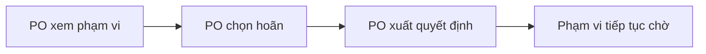

## 1. User Story
<Là vai trò, tôi muốn hành vi để đạt giá trị.>

## 2. Flow
<Bảng bước + flowchart LR cùng nghĩa.>

## 3. Data and rules
<Fields, constraints, source rules.>

## 4. Acceptance Criteria
| ID | Given | When | Then |
|---|---|---|---|
| AC-<n> | <dữ liệu/trạng thái> | <một sự kiện> | <kết quả> |

## 5. Edge cases
<Rỗng, lỗi, quyền, đồng thời hoặc lý do NA.>

## 6. UI
<Screen/state hoặc no_ui. Ảnh thật hoặc ASCII. Scenario detail nếu cần.>

<!-- example: us/US-01.md
---
id: US-01
type: us
title: "Hoãn duyệt"
updated: "2026-10-07"
status: draft
epic: "E1 Quyết định phạm vi"
trace: {req: [REQ-01]}
screens: [S01]
scenarios:
  - id: SCN-01-01
    ac: [AC-01]
    method: review
    status: planned
---

## 1. User Story
Là PO, tôi muốn hoãn quyết định để phạm vi chưa quyết tiếp tục chờ.
## 2. Flow
| Bước | Hành động | Phản hồi |
|---|---|---|
| 1 | PO xem phạm vi | Bộ duyệt hiện phạm vi |
| 2 | PO chọn hoãn | Bộ duyệt giữ lựa chọn hoãn |
| 3 | PO xuất quyết định | File chứa lựa chọn hoãn |
| 4 | Runner nhập quyết định hợp lệ | Phạm vi tiếp tục chờ |


## 3. Data and rules
Đầu vào gồm phạm vi đã liệt kê và lựa chọn defer. Quy tắc thuộc FC-01.AC-01.
## 4. Acceptance Criteria
| ID | Given | When | Then | Source |
|---|---|---|---|---|
| AC-01 | Phạm vi đang chờ và file quyết định hợp lệ ghi defer | Runner nhập file | Phạm vi vẫn chờ | FC-01.AC-01 |
## 5. Edge cases
Quyết định sai hash hoặc ngoài phạm vi bị từ chối theo format/packet-interchange.md §4. Không sửa expected để hợp UI.
## 6. UI
Màn hình S01, state normal trong ví dụ cú pháp. Chưa có UI build hoặc ảnh.
```text
[Phạm vi đang chờ] [Hoãn quyết định]
```
| Scenario | AC | Precondition / data | Steps | Expected | Method / evidence |
|---|---|---|---|---|---|
| SCN-01-01 | AC-01 | File hợp lệ có defer | Nhập file quyết định | Phạm vi vẫn chờ | review; planned, chưa có receipt |
-->
